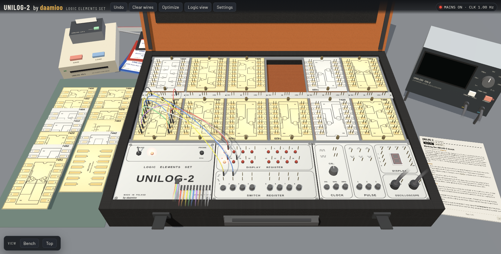

# UNILOG-2

A 3D recreation of the UNILOG-2 logic trainer, the suitcase full of 74xx modules we use in the digital logic labs. It's as close to the real one as I could get from just a few pictures, with some quality of life features added that only a digital version can have.

I made it so I could practise wiring circuits without having the exact layouts in front of me. There's just not enough time to do all the circuits in the lab, and any mistake takes way too long to correct without an exact wiring diagram. Here you can build a circuit, check that it works, and print a numbered wiring list to follow on the real case, a bit like a pick and place machine.

Try it here: https://daamioo.github.io/unilog2/

## What's in it

The case has its 12 slots and the modules from the lab: 7400, 7402, 7404, 7410, 7420, 7442, 7450, 7451, 7474, 7476, 7483 and 7486, plus a splitter board. They come on both kinds of boards we had, the cream ones and the grey ones with mirrored pin numbers. Like on the real case, a chip does nothing until its +5V and 0V are cabled to the rail, unconnected inputs float high, and shorting +5V to 0V trips the supply.

The rest of the bench is around the case:

- the module rack on the left, where you drag chips from
- two sheets in the lid: the logic view, which draws whatever you wired as gates you can edit and build back onto the case (you can drag things around, bend the wires and pick how the lines are drawn), and the truth table
- the lab manual, with the help and a datasheet for every chip
- an oscilloscope
- a floppy drive for saving and loading, the example circuits on floppies next to it, and a little printer that prints a wiring list you can follow on the real case

## Controls

Click a pin, then another pin, to run a cable. Right-drag turns the view, middle-drag pans and scroll zooms. The manual on the table explains the rest.

It works from the keyboard too. Tab into the bench, move with Tab or the arrow keys and press Enter to use something. On a module, type a pin number to jump to that pin.

| Keys | Do |
|---|---|
| 1–8 | switches |
| Shift+1–3 | hold a pulse |
| M | MAINS |
| C | clock range |
| [ / ] | cable colour |
| R | turn a module |
| + / − | turn the selected knob |
| L / T | logic view / truth table on the screen |
| H / O | manual / oscilloscope |
| Esc | back from a close-up |
| B | default bench view |
| P | print |
| Ctrl+S / Ctrl+O | save / load a file |
| Ctrl+Z | undo |

Nothing needs installing, but the first load needs internet to fetch three.js. Your bench is saved in the browser as you go.

UNILOG-2 is the name of the original trainer. This is my own project and isn't connected to the people who made it.

## Licence

Copyright © 2026 daamioo. All rights reserved. You can use the site for personal and educational purposes, but the code can't be copied, changed or shared without my permission. See [LICENSE](LICENSE).
